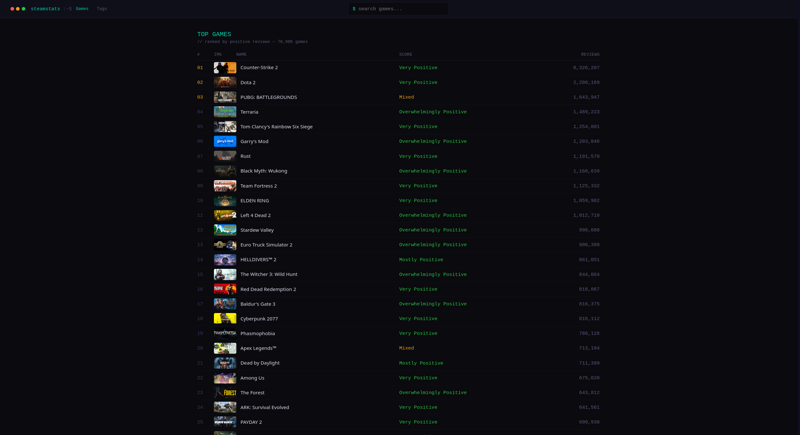
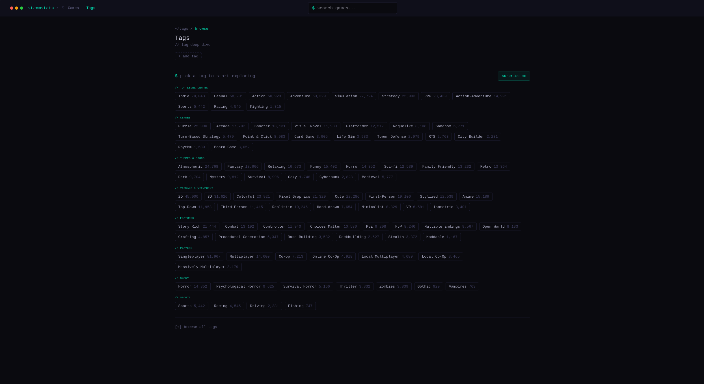

# SteamStats

A SteamDB-style analytics tool for exploring 171k+ Steam games: tag trends, tag combination gaps and review rankings.

## Features

- **Top games ranking** with review score, review counts and pagination
- **Tag deep dive**: pick one or more tags and see total games, first release, peak year, average review score and a releases-per-year chart
- **Commonly paired with**: see which tags most often appear together with your selection, and add them with one click
- **Tag discovery**: browse popular tags grouped into categories, get suggestions in the tag search, or hit "surprise me"
- **Game search** by name and a **game detail page** with tags
- Games tab for every tag combination, sorted by positive reviews

## Tech stack

| Layer    | Tech                          |
| -------- | ----------------------------- |
| Frontend | React, React Router, Tailwind CSS, Axios, Vite |
| Backend  | Python, FastAPI               |
| Database | SQLite                        |

## API overview

| Endpoint | Description |
| -------- | ----------- |
| `GET /games/top` | Top games by positive reviews (paginated) |
| `GET /games/by-tags?tags=a,b` | Games matching all given tags |
| `GET /games/search?q=` | Search games by name |
| `GET /games/{steam_id}` | Game details and tags |
| `GET /tags/top` | Most used tags |
| `GET /tags/all` | Every tag with game count |
| `GET /tags/search?q=` | Tag search |
| `GET /tags/stats?tags=a,b` | Stats for a tag combination |
| `GET /tags/timeline?tags=a,b` | Releases per year for a tag combination |
| `GET /tags/paired?tags=a,b` | Tags that most often co-occur with the selection |

## Database

SQLite with three main tables: `games`, `tags` and `game_tags` (a join table linking `game_id` to `tag_id`).

## Author

Mohamed Muhuyadin ([@MidoLore](https://github.com/MidoLore))
